<a id="top"></a>

<div align="center">


<br/>
<a href="#what-tasteframe-does">
  
</a>

<p>
  <b>Tasteframe turns one photo into Instagram Stories that look like you.</b> It reads your
  photo's light, colour and subject, asks <a href="https://www.qloo.com/">Qloo</a> what your
  favourite artists and films say about your taste, and hands you three Story layouts ranked
  for both. Then everything on the Story is yours to move, crop and restyle.
</p>

<p>
  
  
  
  
  <br />
  
  
  <a href="CONTRIBUTING.md"></a>
  <a href="https://github.com/divyanshu-patil/tasteframe/commits/main"></a>
</p>

<p>
  <a href="#what-tasteframe-does"><kbd>&nbsp;Features&nbsp;</kbd></a>&nbsp;
  <a href="#screenshots"><kbd>&nbsp;Screenshots&nbsp;</kbd></a>&nbsp;
  <a href="#the-mvp"><kbd>&nbsp;The MVP&nbsp;</kbd></a>&nbsp;
  <a href="#under-the-hood"><kbd>&nbsp;Stack&nbsp;</kbd></a>&nbsp;
  <a href="#credits"><kbd>&nbsp;Credits&nbsp;</kbd></a>&nbsp;
  <a href="CONTRIBUTING.md"><kbd>&nbsp;Contributing&nbsp;</kbd></a>
</p>

</div>

<br />

## Why we built Tasteframe

Most Instagram Stories start the same way: a good photo, then twenty minutes of scrolling
Pinterest for a layout, then giving up and posting it plain. The look you wanted exists. It's
just scattered across a thousand pins, none of them made for your photo.

The tools that exist each solve a third of the problem:

<table>
  <tr>
    <td align="center" width="33%">🧩<br /><b>Template apps</b><br /><sub>hand you the same twenty layouts everyone else is using, whatever the photo</sub></td>
    <td align="center" width="33%">📌<br /><b>Pinterest</b><br /><sub>shows you the look, then leaves you to rebuild it by hand in five other apps</sub></td>
    <td align="center" width="33%">🎨<br /><b>Design tools</b><br /><sub>can make anything, if you have an hour and already know what you want</sub></td>
  </tr>
</table>

> [!IMPORTANT]
> **Nobody starts from the photo and the person.** A sunset and a selfie shouldn't get the same
> layout, and neither should someone who lives on indie folk and someone who lives on drill.

That is Tasteframe. It looks at the photo (light, colour, who or what is in it), listens to
your taste through Qloo, and picks from 90 layouts modelled on real Pinterest Stories. Then it
gets out of the way: every word, sticker, strip and photo box on the Story can be moved and
tuned until it's yours.

<div align="center">
<table>
  <tr>
    <td align="center" width="20%"><h3>📷</h3><b>Upload</b><br /><sub>1 to 4 photos</sub></td>
    <td align="center">→</td>
    <td align="center" width="20%"><h3>🔎</h3><b>Read the mood</b><br /><sub>light, colour, subject</sub></td>
    <td align="center">→</td>
    <td align="center" width="20%"><h3>🎧</h3><b>Add your taste</b><br /><sub>artists, films, brands via Qloo</sub></td>
    <td align="center">→</td>
    <td align="center" width="20%"><h3>🗂️</h3><b>Three Stories</b><br /><sub>ranked for you, shuffle for more</sub></td>
    <td align="center">→</td>
    <td align="center" width="20%"><h3>✂️</h3><b>Make it yours</b><br /><sub>edit, then a 1080 × 1920 PNG</sub></td>
  </tr>
</table>
</div>

<br />

## Screenshots

<div align="center">
<table>
  <tr>
    <td align="center" width="50%">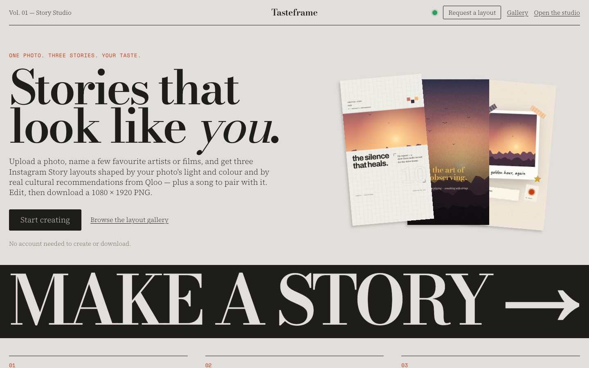</td>
    <td align="center" width="50%">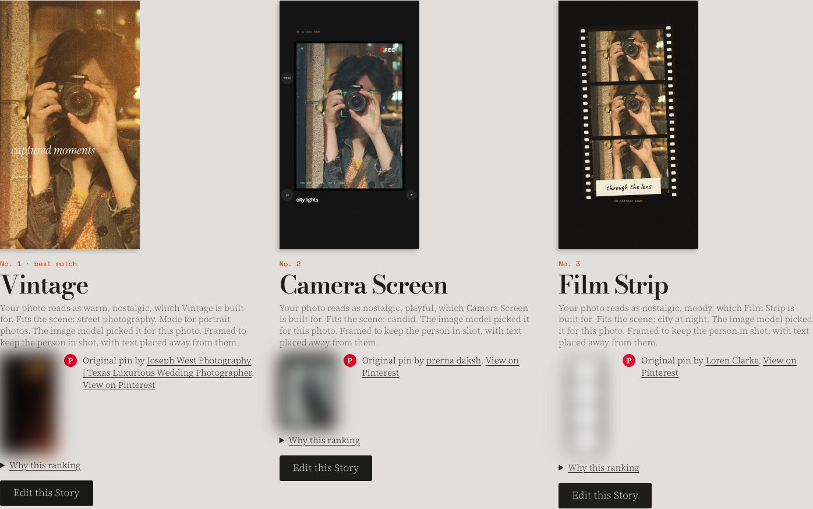</td>
  </tr>
  <tr>
    <td align="center"><sub><b>Landing</b>, with the server-status dot and Request a layout</sub></td>
    <td align="center"><sub><b>Three Stories</b>, each with the Pinterest pin it came from</sub></td>
  </tr>
  <tr>
    <td align="center">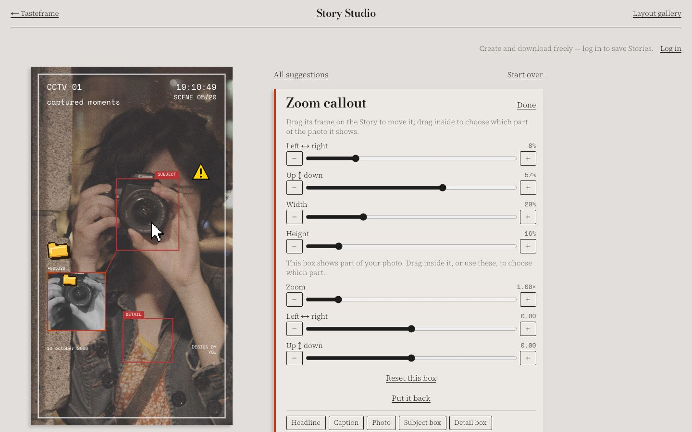</td>
    <td align="center">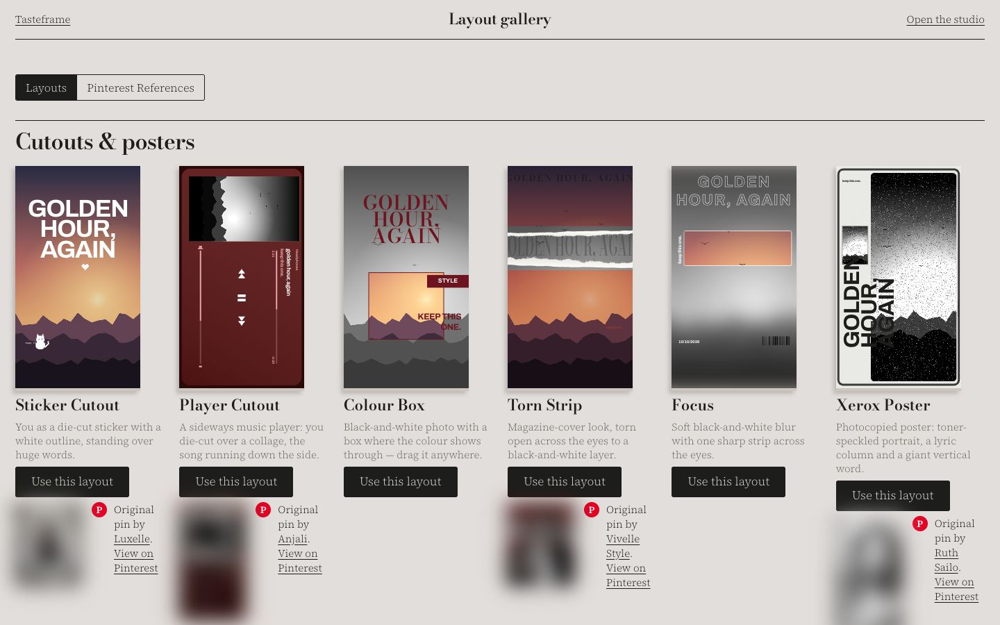</td>
  </tr>
  <tr>
    <td align="center"><sub><b>Editor</b>: tap anything, tune it in the inspector</sub></td>
    <td align="center"><sub><b>Gallery</b>: pick a layout first, then add your photo</sub></td>
  </tr>
</table>
</div>

**Stories it makes** (one photo, ten layouts)

<div align="center">
<table>
  <tr>
    <td align="center" width="20%">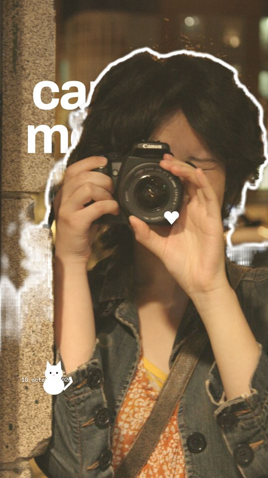</td>
    <td align="center" width="20%">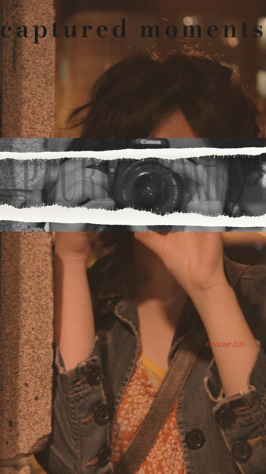</td>
    <td align="center" width="20%">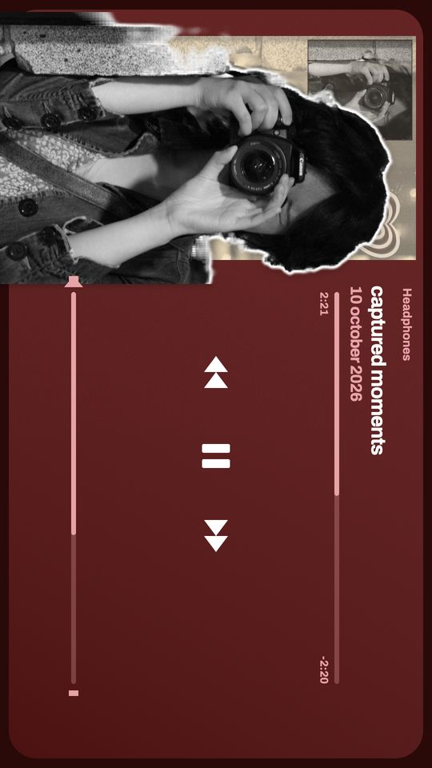</td>
    <td align="center" width="20%">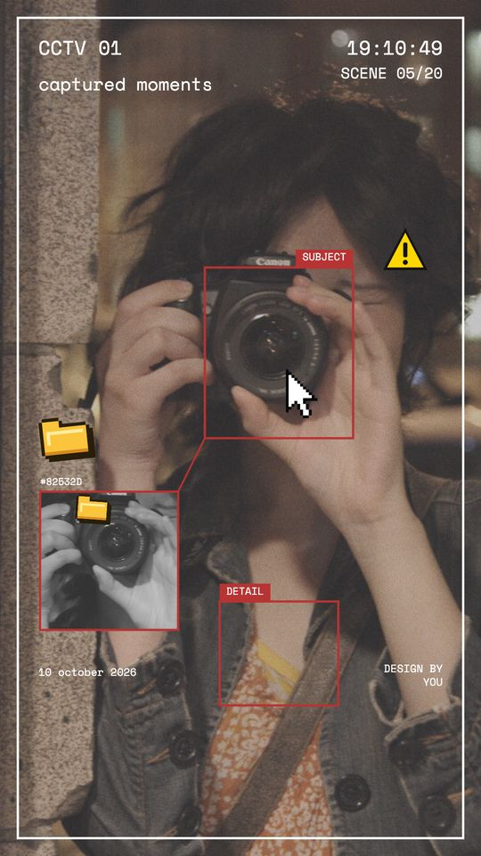</td>
    <td align="center" width="20%">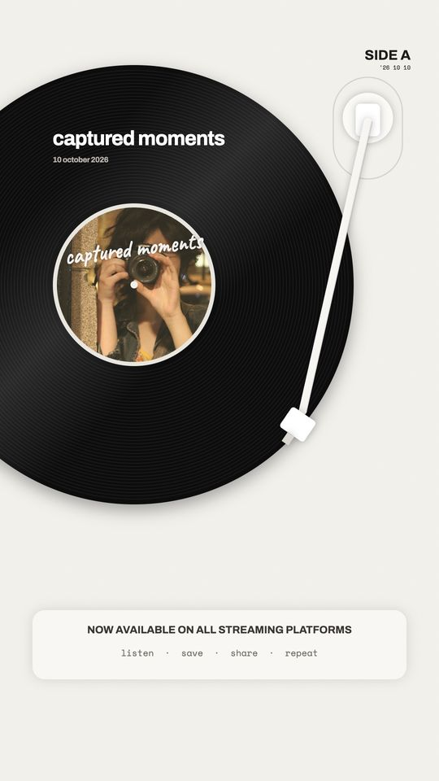</td>
  </tr>
  <tr>
    <td align="center"><sub><b>Sticker Cutout</b></sub></td>
    <td align="center"><sub><b>Torn Strip</b></sub></td>
    <td align="center"><sub><b>Player Cutout</b></sub></td>
    <td align="center"><sub><b>CCTV</b></sub></td>
    <td align="center"><sub><b>Vinyl</b></sub></td>
  </tr>
  <tr>
    <td align="center">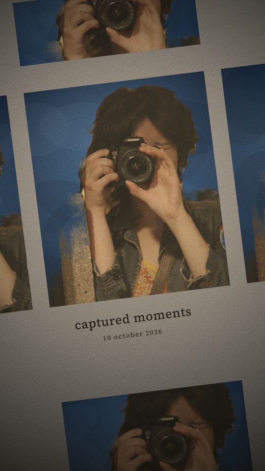</td>
    <td align="center">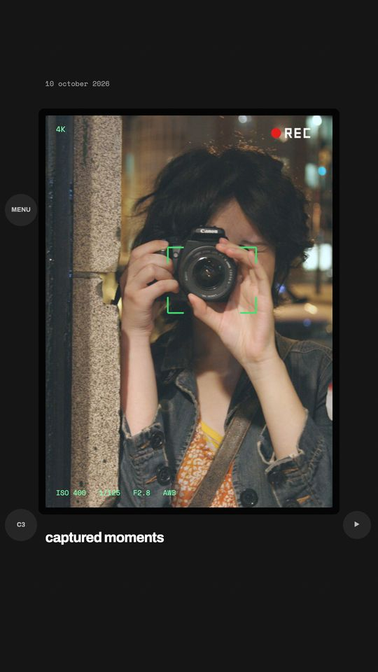</td>
    <td align="center">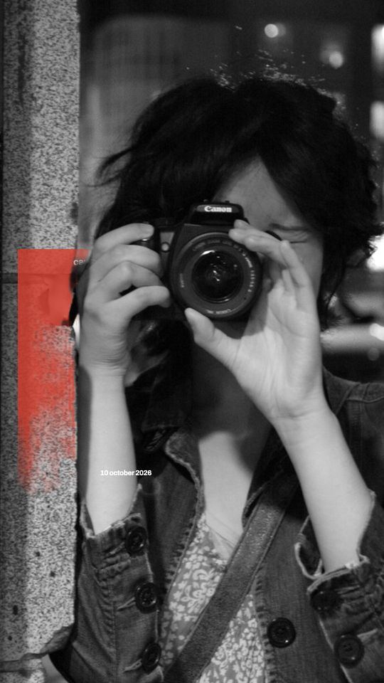</td>
    <td align="center">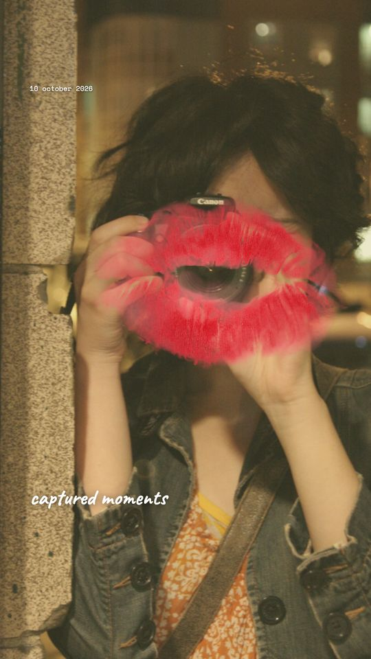</td>
    <td align="center">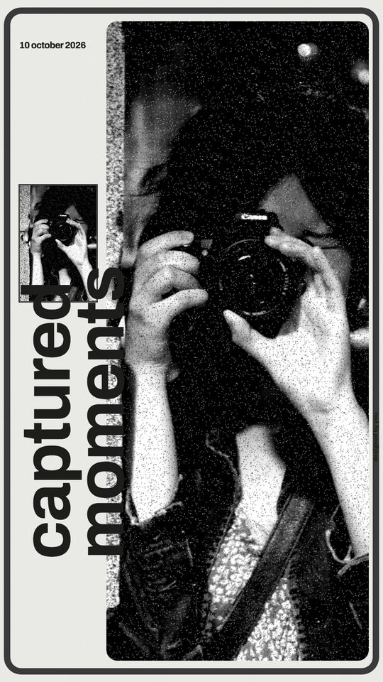</td>
  </tr>
  <tr>
    <td align="center"><sub><b>Yearbook</b></sub></td>
    <td align="center"><sub><b>Camera Screen</b></sub></td>
    <td align="center"><sub><b>Red Block</b></sub></td>
    <td align="center"><sub><b>Kiss Mark</b></sub></td>
    <td align="center"><sub><b>Xerox Poster</b></sub></td>
  </tr>
</table>
<sub>Demo photo: <a href="https://www.flickr.com/photos/35034347371@N01/15904093">"Goddess_Spiral's awesome photos…"</a> by roland, CC0. Pinterest thumbnails are blurred in these captures.</sub>
</div>

<br />

## What Tasteframe does

The heart of Tasteframe is two steps: **pick the right layouts for this photo and this person,
then let you shape every part of the Story.** Around that core sit the gallery, saved Stories
and a way to ask for the layout you want next.

### 🔎 1. Reads your photo, not your face

The API measures palette, brightness, contrast, saturation and warmth with Pillow, and maps
them to broad moods: warm, moody, dreamy, bold and so on. With a vision model switched on
(Gemma 4 on Ollama Cloud), it also names the scene ("golden hour", "airport"), the main
subject and where it sits, and pose cues like *face close-up*, *pout* or *mirror selfie*.

- **Subject-aware framing.** The crop starts on the subject, and text moves to the half of
  the frame away from their face.
- **Never identity.** The prompt forbids identifying anyone or guessing age, gender,
  ethnicity or anything sensitive; replies are filtered again on the way in.
- **Privacy on upload.** Photos go straight to a private bucket through short-lived upload
  links, are re-encoded without EXIF/GPS, and expire after a day unless you save the Story.

### 🎧 2. Picks a song for your photo's vibe, and listens to your taste through Qloo

Every photo gets a song, no account needed. The vision model reads the pose, expression and
styling as a vibe (baddie, aesthetic, toxic, friendly, sweet, cute, romantic, chill, sad, party),
which selects a hand-curated artist pool in your chosen language (English with US/UK artists,
Hindi, Punjabi, Spanish or Korean), built from public Spotify, YouTube Music and Reels chart
reporting. The vision model then ranks about fifteen candidate songs against what it saw in the
photo, preferring songs that are trending right now (Apple Music's most-played chart, plus songs
reported trending on Reels). Songs arrive a few seconds after the layouts, and every layout gets
its own song, so shuffling shows new ones.

Logged in, you can also name favourite artists, films or brands. [Qloo](https://www.qloo.com/)
returns the culture around them (blended with the vibe artist) and its tags ("indie", "funk",
"noir") lean the layout ranking. Apple's catalogue supplies real song titles, never invented ones.

### 🗂️ 3. Picks three of 90 layouts, and shows where each came from

Every layout was rebuilt from real Pinterest Story references, from Torn Strip magazine
covers to sideways Spotify players, CCTV frames, yearbook sheets and photocopied lyric posters.

```
score = 0.30 visual + 0.30 AI pick + 0.25 cultural + 0.15 readability
```

- **Ranked for this photo.** Different photos get different sets; *Shuffle* moves through the
  rest of the ranked list three at a time, each set from different layout families.
- **The original is one tap away.** Every suggestion shows the pin it was modelled on, with
  the creator credited and a link to Pinterest.
- **One to four photos.** Multi-photo layouts suggest themselves when you upload more, and
  photos can be added later.

### ✂️ 4. Lets you move everything

Tap anything on the Story and the inspector shows exactly its controls, with sliders, −/+
nudges and arrow keys for fine work.

<table>
  <tr>
    <td width="50%" valign="top">
      <h4>🖼️ Every photo box</h4>
      Drag inside any box that shows part of a photo (repeated bands, collage tiles, the
      CCTV callout, the vinyl label) to choose what it shows; zoom, fit or turn it 90°.
    </td>
    <td width="50%" valign="top">
      <h4>📦 Every frame and strip</h4>
      CCTV boxes, the torn strip, the colour box, the red block and the cut-out you all move
      by their frame and resize in the inspector. The red block can sit behind you or in front.
    </td>
  </tr>
  <tr>
    <td valign="top">
      <h4>🧍 Cutouts on your device</h4>
      MediaPipe segments the person in the browser (nothing is uploaded for it), with a
      die-cut outline whose thickness, colour and gap from you are all adjustable.
    </td>
    <td valign="top">
      <h4>🎵 A real song sticker</h4>
      Instagram-style music stickers with the song's actual album art, found by search or
      suggested from your taste, or your own image.
    </td>
  </tr>
  <tr>
    <td valign="top">
      <h4>💋 Stickers &amp; elements</h4>
      Paper stickers plus transparent elements (lipstick kiss, focus brackets, REC, torn
      paper, a Spotify-style playlist panel). The layout's own elements are stickers too.
    </td>
    <td valign="top">
      <h4>🎞️ Twelve filters</h4>
      Film, Golden hour, Faded, Sepia, Noir, 8mm, Xerox and more, computed per pixel so the
      preview is exactly the export.
    </td>
  </tr>
</table>

### 📥 5. Export, save, come back

Download a 1080 × 1920 PNG and post it, then add the suggested song with Instagram's own music
sticker. Or download the Story as a video (MP4 where the browser supports it, else WebM) with an
audio file you have the rights to.
Log in to keep up to 20 Stories in your account and reopen them on any device.

### 📌 6. Ask for the layout you want next

The gallery shows every layout and every reference pin. If yours isn't there, paste a
Pinterest link into **Request a layout**: an instant preview confirms it's the right pin, and
it lands in the admin queue.

<div align="right"><a href="#top"><sub>↑ back to top</sub></a></div>

## Also in the app

<table>
  <tr>
    <td width="50%" valign="top">
      <h4>🟢 Honest server status</h4>
      A small dot in the navbar breathes yellow while the free-tier API wakes up (about
      50 seconds), turns green when it answers and red if it can't, so a cold start never
      looks like a broken site.
    </td>
    <td width="50%" valign="top">
      <h4>📊 Analytics without tracking people</h4>
      Page views, Stories made, downloads and referring sites, with no cookies, no IPs and
      no accounts attached. Do Not Track and Global Privacy Control switch it off.
    </td>
  </tr>
  <tr>
    <td valign="top">
      <h4>🛡️ An admin dashboard</h4>
      Traffic, referrers, devices, the most-downloaded layouts and the request queue, each
      request opening with the pin, the note and where it came from. Accounts live in a users
      table with a <code>user</code> or <code>admin</code> role, enforced by the database, not the page.
    </td>
    <td valign="top">
      <h4>🧭 Works when the API doesn't</h4>
      If analysis or Qloo is down, you still get standard layouts, and the editor and export
      never need the network at all.
    </td>
  </tr>
</table>

<br />

## The MVP

A complete loop, not a demo. Everything marked shipped is built, tested and running.

| Area | Status |
| :-- | :--: |
| **Core:** upload 1–4 photos, visual mood, subject-aware framing |  |
| **Core:** Qloo taste search and insights, cultural ranking, music suggestion |  |
| **Core:** 90 layouts ranked per photo, with Shuffle and Pinterest originals |  |
| **Core:** editor with inspector, movable boxes, cutouts, filters, stickers, song sticker |  |
| 1080 × 1920 PNG export |  |
| Vision reasoning (Gemma 4 on Ollama Cloud) |  |
| Accounts and saved Stories (Supabase, row-level security) |  |
| Gallery, Request a layout, admin dashboard, analytics |  |
| Live Qloo calls verified against a hackathon key |  |
| Hosted deployment |  |
| Video export with your own audio |  |
| Animated Stories |  |

> [!NOTE]
> **Tasteframe never posts for you.** It makes the image; you post it with Instagram's own
> tools, which is also the only legitimate way to attach licensed music to a Story.

<div align="right"><a href="#top"><sub>↑ back to top</sub></a></div>

## Under the hood

The short version. Setup, architecture and conventions live in **[CONTRIBUTING.md](CONTRIBUTING.md)**.

<table>
  <tr>
    <td width="20%"><b>Web</b></td>
    <td>&nbsp;Next.js 16&nbsp;&nbsp;&nbsp;&nbsp;&nbsp;React 19&nbsp;&nbsp;&nbsp;&nbsp;&nbsp;TypeScript&nbsp;&nbsp;&nbsp;&nbsp;&nbsp;Canvas renderer</td>
  </tr>
  <tr>
    <td><b>On-device AI</b></td>
    <td>&nbsp;MediaPipe selfie segmentation (person cutouts, in the browser)</td>
  </tr>
  <tr>
    <td><b>API</b></td>
    <td>&nbsp;FastAPI&nbsp;&nbsp;&nbsp;&nbsp;&nbsp;Python 3.12&nbsp;&nbsp;&nbsp;&nbsp;&nbsp;Pydantic&nbsp;&nbsp;&nbsp;&nbsp;Pillow&nbsp;&nbsp;&nbsp;&nbsp;httpx</td>
  </tr>
  <tr>
    <td><b>Taste &amp; music</b></td>
    <td>Qloo Taste AI (insights, search)&nbsp;&nbsp;&nbsp;&nbsp;&nbsp;iTunes Search (song titles, album art)</td>
  </tr>
  <tr>
    <td><b>Vision</b></td>
    <td>&nbsp;Ollama Cloud, Gemma 4 (optional)</td>
  </tr>
  <tr>
    <td><b>Data &amp; auth</b></td>
    <td>&nbsp;Supabase Postgres + Auth, row-level security&nbsp;&nbsp;&nbsp;&nbsp;&nbsp;AWS S3 (private, presigned)</td>
  </tr>
  <tr>
    <td><b>Tooling</b></td>
    <td>&nbsp;Turborepo&nbsp;&nbsp;&nbsp;&nbsp;&nbsp;pnpm&nbsp;&nbsp;&nbsp;&nbsp;&nbsp;Vitest&nbsp;&nbsp;&nbsp;&nbsp;&nbsp;pytest&nbsp;&nbsp;&nbsp;&nbsp;&nbsp;Ruff&nbsp;&nbsp;&nbsp;&nbsp;&nbsp;Playwright e2e</td>
  </tr>
</table>

> [!TIP]
> **Runs with no cloud accounts at all.** Leave the keys out and uploads go to a local folder,
> layouts are ranked on visual signals only, and the UI says so plainly. Add a Qloo key,
> an S3 bucket, Supabase or Ollama one at a time as you need them.

<details open>
<summary><b>Three things worth knowing about the shape of it</b></summary>
<br />

- **Rendering is a pure function.** `renderStory(ctx, photos, state)` draws the Story from a
  serializable state and nothing else, so the preview, the thumbnails and the 1080 × 1920
  export are the same pixels, and every layout is covered by deterministic tests.
- **Secrets never reach the browser.** Qloo, AWS and Ollama calls happen on the API; the browser
  only talks to same-origin `/api` and short-lived upload links. Saved Stories, requests and
  analytics are guarded by Postgres row-level security as well as the API.
- **One monorepo.** The web app in `apps/web`, the FastAPI service in `apps/api`, wired
  together with Turborepo.

```
tasteframe/
├── apps/
│   ├── web/        Next.js app: studio, editor, Canvas layouts, gallery, admin
│   └── api/        FastAPI: uploads, vision, Qloo, ranking, music, stories, insights
├── design-refs/    Pinterest reference index (links and credits only)
├── docs/           API contracts, validation matrix, AWS templates, screenshots
└── supabase/       schema, apply and admin scripts
```

</details>

<div align="right"><a href="#top"><sub>↑ back to top</sub></a></div>

## Credits

<table>
<tr>
<td align="center" width="33%">
  <a href="https://www.qloo.com/"><b>Qloo</b></a><br />
  <sub>The taste layer: cultural insights behind the ranking and the music pick</sub>
</td>
<td align="center" width="33%">
  <a href="https://www.pinterest.com/"><b>Pinterest creators</b></a><br />
  <sub>Every reference pin is linked and credited in the app and in <code>design-refs/</code>; no pin images are stored</sub>
</td>
<td align="center" width="33%">
  <a href="https://ai.google.dev/edge/mediapipe"><b>MediaPipe</b></a><br />
  <sub>The selfie segmenter behind every cutout (Apache-2.0)</sub>
</td>
</tr>
<tr>
<td align="center">
  <a href="https://ollama.com/"><b>Ollama</b></a><br />
  <sub>Gemma 4 for scene and subject reasoning</sub>
</td>
<td align="center">
  <a href="https://openverse.org/"><b>Openverse</b></a><br />
  <sub>Openly licensed prop photos for the Playlist layout, credited in the app</sub>
</td>
<td align="center">
  <a href="https://www.apple.com/apple-music/"><b>Apple Music</b></a><br />
  <sub>Song titles and album artwork via the iTunes Search API</sub>
</td>
</tr>
</table>

<br />

## The team

<table>
<tr>
<td align="center" width="100%">
  <a href="https://github.com/divyanshu-patil"><br /><b>Divyanshu Patil</b></a><br />
  <sub>Creator</sub>
</td>
</tr>
</table>

<br />

## Contributing

Contributions are welcome, from a typo to a whole new layout. Everything a developer needs
(prerequisites, environment variables, running the web app and the API, the architecture,
adding a layout, the conventions we hold to and how to open a good pull request) lives in
**[CONTRIBUTING.md](CONTRIBUTING.md)**.

<p>
  <a href="CONTRIBUTING.md"></a>
</p>

## License

MIT. © 2026 Divyanshu Patil. See [LICENSE](LICENSE).

<div align="center">
<br />
<sub>Built one Story at a time.</sub>
<br /><br />
<a href="#top"><sub>↑ back to top</sub></a>
</div>


