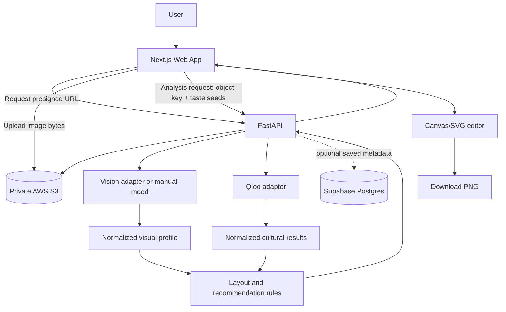

# Architecture — Qloo Story Maker

## 1. Goal and boundaries

Turn one photo into personalized Instagram Story compositions by combining:
1. **Visual signals** extracted by a vision model or manual controls.
2. **Cultural signals** from user-confirmed favorite entities and Qloo's supported taste/affinity API.
3. **Local layout rules** that choose and render templates.
4. **Music metadata** from Qloo only if the current schema/account supports track-level entities; otherwise clearly labelled artist recommendation plus a permitted track catalogue/provider.

Do not claim Qloo reads raw image pixels or renders layouts. Do not claim an exact song is Qloo-recommended when Qloo returned only an artist.

## 2. Architecture decisions

- Monorepo: pnpm workspaces + Turborepo.
- Web: Next.js App Router, React, TypeScript.
- API: FastAPI, Python 3.11+ (confirm host support).
- Database: Supabase Postgres only if persistence is needed.
- File storage: private AWS S3 bucket; FastAPI issues short-lived presigned upload URLs.
- Qloo: backend-only calls.
- Story renderer: browser Canvas/SVG; fixed 9:16 canvas, default 1080×1920.
- MVP: guest mode; add Supabase Auth only if saved history/accounts are essential.
- No paid image generation required.

## 3. Diagram



## 4. Responsibilities

### `apps/web`
- Upload picker with MIME/size validation and local preview.
- Optional user taste seeds (favorite artist, film, brand, etc.).
- Progress, error, empty, retry and Qloo-unavailable states.
- Three distinct layout previews and a “why this was suggested” panel.
- Editor for caption, text size/color/alignment/position, crop and overlays.
- PNG export at 1080×1920.
- No Qloo key, AWS secret or Supabase service-role key in client bundles.

### `apps/api`
- Validate requests and image metadata.
- Issue presigned S3 upload URLs.
- Verify object key/session association and uploaded object metadata.
- Run optional visual-analysis adapter.
- Resolve taste seeds with supported Qloo entity search/lookup.
- Query Qloo Insights using only documented, account-enabled parameters.
- Normalize raw provider data into internal schemas.
- Apply timeouts, bounded retries, rate limits, request IDs and safe errors.
- Optional Supabase persistence and deletion.

### Supabase
Store only what is needed: optional user/session ID, confirmed taste seeds, story configuration JSON, opaque S3 object key, timestamps and minimal sanitized recommendation provenance. Do not store image bytes or signed URLs.

### S3
- Private bucket; Block Public Access enabled.
- Random object keys; do not use original filenames as keys.
- Short-lived presigned PUT URLs.
- Validate MIME type, size and actual image decoding after upload.
- Least-privilege IAM restricted to required bucket/prefix.
- Lifecycle expiry for temporary uploads and generated assets.

### Qloo adapter
Owns auth, base URL, endpoint parameters, timeouts, response parsing, retry policy and provider errors. UI never depends on raw Qloo response fields. Cache only when Qloo terms permit it; cache key includes all query inputs and API/schema version.

## 5. End-to-end flow

1. User chooses a photo and optional cultural seeds.
2. Client checks size/type; server repeats validation.
3. Web requests a presigned URL from FastAPI and uploads directly to S3.
4. Web sends object key, seeds and optional manual mood to FastAPI.
5. API verifies object ownership and streams/fetches image for the vision adapter.
6. Vision adapter returns broad aesthetic signals: palette, brightness, composition and mood. Do not infer identity, ethnicity, age, health or sensitive attributes.
7. Qloo resolves confirmed user seeds and returns supported related entities/tags.
8. Local recommendation engine combines visual profile and cultural evidence.
9. API returns three layout IDs, rationales and a verified artist/track recommendation.
10. Browser renders editable layouts and exports PNG.
11. Temporary source object expires or is explicitly deleted.

## 6. Layout strategy

Start with a small, deterministic template catalogue:
- `cinematic`: large photo, bottom gradient, restrained typography.
- `editorial`: asymmetric crop, strong headline and small caption.
- `scrapbook`: framed photo, paper-like elements and stickers.
- `minimal`: full-bleed photo and minimal caption.
- `collage`: controlled grid of photo crops and text.

Initial heuristic (tune by human review):
`score = visual_fit * 0.45 + cultural_style_fit * 0.35 + readability_fit * 0.20`

This is a product heuristic, not a validated scientific model. Explain recommendations and let users override them.

## 7. Music strategy

Separate artist recommendation, track metadata, playback rights and Instagram music usage.
1. If Qloo track-level entities are supported and returned, show verified track title/artist.
2. If only an artist is returned, label it as an artist recommendation.
3. Optionally map the artist to a track from a permitted curated metadata catalogue or provider.
4. Do not scrape streaming services or redistribute copyrighted audio.
5. For MVP, let the user add the song through Instagram's native music sticker.

## 8. Proposed repo layout

```text
.
├── AGENTS.md
├── architecture.md
├── plan.md
├── requirements.md
├── qloo_API.md
├── acceptance-criteria.md
├── .env.example
├── package.json
├── pnpm-workspace.yaml
├── turbo.json
├── apps/
│   ├── web/ (existing Next.js App Router)
│   │   ├── app/
│   │   ├── components/
│   │   ├── features/{upload,story-editor,recommendations,taste-profile}/
│   │   └── lib/
│   └── api/
│       ├── pyproject.toml
│       ├── requirements.txt
│       └── app/{main.py,api/routes/,core/,schemas/,services/{qloo,storage,vision,recommendations}/,tests/}
├── packages/{ui,eslint-config,typescript-config}/
├── docs/{api-contracts.md,validation-matrix.md}
└── supabase/schema.sql
```

Python does not need to be a pnpm workspace package. Turborepo can run API scripts via `apps/api/package.json`; Python dependencies remain in a venv.

## 9. Deployment and cost

- Next.js: Vercel or another Next.js-compatible host; verify current plan limits.
- FastAPI: Python-capable host; check sleeping/cold starts, outbound requests and free-plan terms.
- Supabase: free tier if quotas and project policies suit the demo.
- S3: private bucket in a suitable region; check storage, request and egress pricing.
- Qloo key: production secret manager only.

“Only Qloo is paid” is a target, not a guarantee: S3, hosting, egress or databases can cost money beyond free limits. Set billing alerts and lifecycle cleanup.

## 10. Security and privacy

- Commit `.env.example`, never actual `.env` files.
- Keep `QLOO_API_KEY`, AWS credentials and Supabase service-role key server-side.
- Use short-lived signed URLs and random keys.
- Validate image bytes, not just extension/MIME claim.
- Prefer JPEG/PNG/WebP; reject arbitrary SVG as photo input unless sanitized.
- Strip EXIF/GPS metadata where practical.
- Avoid face recognition and sensitive trait inference.
- Rate-limit uploads and analysis; use external-call timeouts.
- Redact signed URLs, API keys, images and sensitive preference text from logs.
- Use Supabase RLS for user-owned records.
- Support deletion and set short retention for temporary assets.
- Render text safely; do not inject arbitrary HTML into the editor.

## 11. Observability

Record request ID, elapsed time by stage, Qloo status class, cache hit/miss, candidate count, fallback used and layout IDs. Never log keys, signed URLs or raw images. A hackathon debug panel can show sanitized seed entities and Qloo-derived evidence.

## 12. Definition of success

- Qloo calls happen only server-side.
- Visual analysis, cultural intelligence and layout rendering are separate modules.
- Guest user completes the main flow.
- Manual mood controls work if vision provider is unavailable.
- Qloo failure is explicit; no static data is falsely labelled as Qloo output.
- User can edit and export without paid image generation.

## 13. As implemented (2026-10-10)

| Concern | Implementation |
|---|---|
| Guest identity | `POST /v1/session` → HMAC-signed token (`X-Session-Token`); object keys `tmp/<session>/<random>.<ext>`; ownership = key prefix match (`app/core/security.py`) |
| Upload | S3 presigned **POST** (policy enforces type + size), or signed local-disk stand-in for dev (`app/services/storage/store.py`) |
| Image validation | Pillow decode, JPEG/PNG/WebP only, pixel cap, decompression-bomb guard, EXIF/GPS stripped and written back (`app/services/vision/analyzer.py`) |
| Vision | Local Pillow statistics → palette, brightness, contrast, saturation, warmth, orientation → rule-based mood words; manual moods merged first |
| Qloo | `app/services/qloo/client.py`: `/search` and `/v2/insights` (artist + movie targets), timeouts, bounded retries, normalized `QlooEntity` |
| Ranking | `app/services/recommendations/layouts.py`: 8-template catalogue, 0.45/0.35/0.20 heuristic, one suggestion per template family |
| Music | Top Qloo artist; exact-artist iTunes Search lookup for a title + Apple Music link (`app/services/music/itunes.py`) |
| Progress | `/v1/analysis` streams NDJSON stage events — the UI's progress list reflects real server stages |
| Web proxy | Next.js rewrite `/api/* → API_BASE_URL` keeps the browser same-origin; `API_BASE_URL` is server-only |
| Renderer | `apps/web/lib/story/{types,draw,templates,editor,export}.ts` — pure, deterministic Canvas 2D; previews and export share `renderStory()` |
| Templates | cinematic, stills, editorial, journal, scrapbook, filmstrip, vintage, minimal — modelled on `design-refs/` |
| Persistence | Optional saved Stories: Supabase `public.stories` via PostgREST RPC (`tf_*` SECURITY DEFINER functions, publishable key / role `anon`), photo copy under `saved/`, 7-day expiry (`app/services/stories/supabase.py`, `app/api/routes/stories.py`) |

Deviations from the original proposal: saved Stories are guest-scoped (no Supabase Auth yet), and the analysis
response is streamed rather than returned as a single JSON body.
